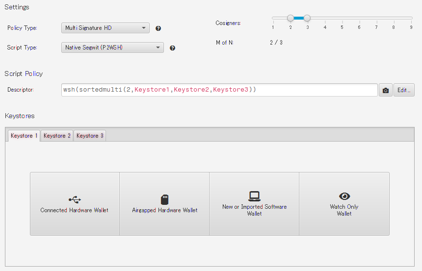

以前マルチシグのことを書いたのが6月だったが、やはりあれ以降も他の被害は増えている。
「ハードウェアウォレット」という名称のせいかもしれないが、使っておけば安心な気持ちが出てしまいやすいのだと思う。

* [btc: マルチシグとその勇気 - hiro99ma blog](https://blog.hirokuma.work/2026/08/20260816-btc.html)
* [btc: とりあえずスクリプトで - hiro99ma blog](https://blog.hirokuma.work/2026/07/20260731-btc.html)

いろいろな種類のハードウェアウォレットがあるが、基本的にはトランザクションに署名するマシンだ。

* ハードウェアウォレットの中だけで乱数を作り、外に漏らさない
* HDウォレット(BIP-32)と、最近のアドレス表記やトランザクションに対応している
* アドレスの生成を求められたら返す
* もらったトランザクションに署名だけして返す

これに人間からの保護や耐タンパなどを付けたりするだろうが、機能的にはこのくらいだと思う。  
前提条件の「乱数が外に漏れない」が崩れると全部崩れる。

1つしか鍵がないので1つ漏れたらダメになる。  
だったらもっと増やしましょう、というのがマルチシグだ。  
スクリプトにするともっと複雑なことはできるのだが、それはそれでウォレットのほうが対応しないだろう。  
一般的なマルチシグなら対応しているウォレットもそこそこある。

これはSparrow Walletだ。偽URLがいくつかあるし検索の上位に出てくるので、ネットで探すときは注意しよう。  
16個まで対応するらしい(サイズ的に15個だと思ってた)。
Descriptorを書き換えてもP2TRのマルチシグにしたりはできなさそうだった。  
画像で文字が赤っぽいところがあるのはWindowsのレンダリングのせいだと思ったけど、Macもそうなのかな？
文字が見づらいのが残念だが、環境変数で`glass.win.uiScale=110%`などとして大きさだけは変更できそうだ(Windowsだけ？)。

MuSig2のマルチシグウォレットもあるのかしら？  
あれはマルチシグというか、schnorr署名の集約機能を使っているので鍵を作るシーケンスは必要だが鍵としては単独鍵のP2TRと同じだ。  
単独鍵のP2TRはアドレスとして公開鍵を使っているからうんぬん、というつぶやきを見たことがあるが、
tweaked-pubkeyとP2WPKHなどのscriptPubKeyに強度的な違いはあるんだろうか？  
総当たり攻撃ができるような時代がやった来たらMuSig2も単独鍵と同じだから効果はなくなるとは思うが。
