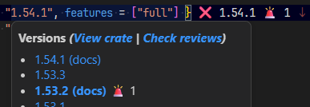

[前回](https://blog.hirokuma.work/2026/10/20261016-rust.html)の記事はあまりにいい加減すぎたのでもうちょっと追記しようとサンプルコードのプロジェクトを開くと`Cargo.toml`のdependenciesに警告っぽいアイコンが表示されていた(前回の記事は tokio 1.53.3 だが、開いたのは別PC)。

"RUSTSEC-2026-0386"という脆弱性報告がある。

* [tokio - crates.io: Rust Package Registry](https://crates.io/crates/tokio/security)
  * [RUSTSEC-2026-0386: tokio: `AsyncFd::new` and related constructors violate I/O safety › RustSec Advisory Database](https://rustsec.org/advisories/RUSTSEC-2026-0386.html)
  * [RUSTSEC-2026-0386 - OSV](https://osv.dev/vulnerability/RUSTSEC-2026-0386)
  * [AsyncFd accepting AsRawFd violates I/O safety and can lead to UB · Issue #8539 · tokio-rs/tokio](https://github.com/tokio-rs/tokio/issues/8539)

[tokio::io::unix::AsyncFd](https://docs.rs/tokio/latest/tokio/io/unix/struct.AsyncFd.html)が受ける`AsRawFd`はあまりチェックせずに受け入れてるとかなんとか。
使ったことがないのでよくわからん。。。  
名前からするとLinuxの生のファイルディスクリプタを扱おうとしているのだろうから、Cのライブラリを持ってきたりする人が使うのかな？

緊急で更新してリリースしないといけない、というタイプではなさそうだけど、カテゴリーが「memory-corruption」だから早めにアップデートはしておくに越したことはなさそう。
そんなことをいうとどのライブラリもそうなんだけどね。  
今回記事にしたのは、単に`Cargo.toml`で見慣れないアイコンが表示されていたためというだけである。
